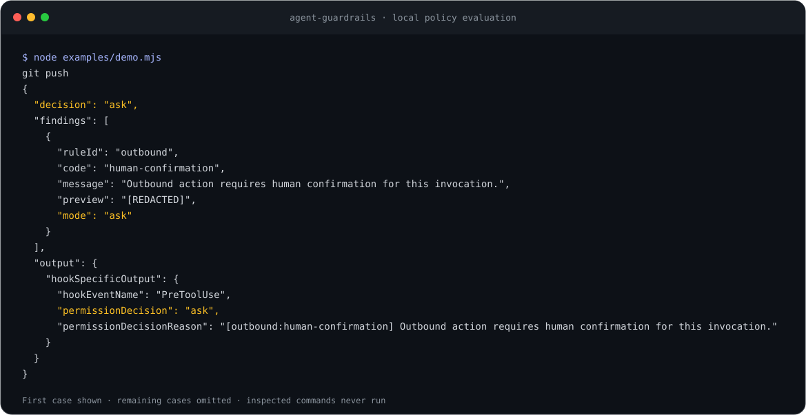

# agent-guardrails

[](https://github.com/YusufBeratZengin/agent-guardrails/actions/workflows/ci.yml) [](LICENSE) [](package.json) [](https://www.npmjs.com/package/agent-guardrails)

Local safety hooks for AI coding agents that catch common secret leaks and destructive commands, and ask before outbound actions.

Node.js 20+ · ESM · Zero runtime dependencies · No network requests or telemetry

[Türkçe](README.tr.md) · [Configuration](docs/configuration.md) · [Threat model](docs/threat-model.md) · [Examples](docs/examples.md)



The first case from `node examples/demo.mjs`; inspected commands never run. [Full output below](#what-a-block-looks-like).

## Why

- **Inspect content as well as commands.** Scan tool payloads for credential formats and check chained commands and literal wrappers for destructive operations.
- **Ask on each outbound action.** Return a fresh `ask` decision for matching send, push and publish calls; the host handles confirmation.
- **Keep policy local and auditable.** Five configurable rules, redacted findings and optional JSONL auditing, with no runtime dependencies or external service.

## 60-second quick start

From the repository root, with Node.js 20+ installed, run these commands in a POSIX shell or PowerShell. No package installation is needed:

```sh
node bin/agent-guardrails.mjs init
node examples/demo.mjs
node bin/agent-guardrails.mjs explain outbound
```

`init` prints Claude Code settings without writing. The demo evaluates three synthetic tool calls and prints `ask`, `deny`, `deny`; it never executes the inspected commands.

To enable the hook **in this checkout**, merge a command that resolves from this repository root:

```sh
node bin/agent-guardrails.mjs init --write --command "node bin/agent-guardrails.mjs hook"
```

`--write` preserves existing settings and creates `settings.json.bak.<timestamp>` before changing an existing file. Repeating the same command is a no-op. Restart Claude Code and inspect `/hooks` to verify installation. For another project, use the [shell and PATH examples](docs/examples.md).

### After the first npm release

Install in your project root and save a hook command that resolves the local dependency:

```sh
npm install --save-dev agent-guardrails
npx agent-guardrails init --write --command "npx --no-install agent-guardrails hook"
```

Keep the development dependency installed wherever the hook runs. `--no-install` avoids fetching packages during hook execution. The default snippet uses `agent-guardrails hook`, which must be on the hook process's PATH; `--command` explicitly selects a command, stored verbatim as a nonempty single line. The npm commands are a release plan; the npm badge may show “not found” until publication. The source commands above work now without registry access.

## What a block looks like

Run the [synthetic demo](examples/demo.mjs) from this checkout:

```sh
node examples/demo.mjs
```

It calls `agent-guardrails test` for each payload in memory. It never runs the inspected commands or writes the synthetic credential to a file.

<details>
<summary>Full CLI output: outbound confirmation, destructive command denial, secret detection</summary>

```text
git push
{
  "decision": "ask",
  "findings": [
    {
      "ruleId": "outbound",
      "code": "human-confirmation",
      "message": "Outbound action requires human confirmation for this invocation.",
      "preview": "[REDACTED]",
      "mode": "ask"
    }
  ],
  "output": {
    "hookSpecificOutput": {
      "hookEventName": "PreToolUse",
      "permissionDecision": "ask",
      "permissionDecisionReason": "[outbound:human-confirmation] Outbound action requires human confirmation for this invocation."
    }
  }
}
git reset --hard
{
  "decision": "deny",
  "findings": [
    {
      "ruleId": "destructive",
      "code": "git-reset-hard",
      "message": "Hard reset discards work.",
      "preview": "[REDACTED]",
      "mode": "deny"
    }
  ],
  "output": {
    "hookSpecificOutput": {
      "hookEventName": "PreToolUse",
      "permissionDecision": "deny",
      "permissionDecisionReason": "[destructive:git-reset-hard] Hard reset discards work."
    }
  }
}
Write with a synthetic AWS key
{
  "decision": "deny",
  "findings": [
    {
      "ruleId": "secrets",
      "code": "aws-access-key",
      "message": "Potential aws-access-key detected.",
      "preview": "[REDACTED]",
      "mode": "deny"
    }
  ],
  "output": {
    "hookSpecificOutput": {
      "hookEventName": "PreToolUse",
      "permissionDecision": "deny",
      "permissionDecisionReason": "[secrets:aws-access-key] Potential aws-access-key detected."
    }
  }
}
```

</details>

The result includes both the policy findings and the Claude Code wire output. `test` exits 0 for all three valid evaluations; hook denial is expressed in JSON. For PowerShell stdin usage, see [the native object example](docs/examples.md#powershell-dry-run).

```text
RULE           DEFAULT  PURPOSE
secrets        deny     Credentials and sensitive reads
destructive    deny     Destructive commands
outbound       ask      Human confirmation on each outbound call
pii            off      Optional personal-data scanning
protect-paths  deny     Writes to protected paths
```

## Rules

| ID | Default | Checks |
| --- | --- | --- |
| `secrets` | deny | Writes, edits, shell commands and MCP inputs: AWS, GitHub, OpenAI, Anthropic, Google keys, private keys, JWT, high-entropy credential assignments; literal reads of credential paths |
| `destructive` | deny | Hard resets, forced clean/push, checkout-all, stash/ref/recovery deletion, primary-branch force deletion, Docker pruning, disk formatting/overwrites, shredding, external truncation, broad recursive deletion, recursive chmod 777, download-to-shell |
| `outbound` | ask | Matching send/publish/merge/spend tools, pushes, PR creation, releases, package publication and common network clients |
| `pii` | off | Optional email/phone heuristics, Luhn cards, mod-97 IBAN in external tool inputs; locale plugin API |
| `protect-paths` | deny | Writes under configured paths; defaults to `~/.ssh`, `~/.aws`, `~/.gnupg` |

Every rule supports `deny`, `ask`, `warn`, `off`. Decision precedence is **deny > ask > warn > pass**. Clean calls and warnings do not auto-approve the host's permission checks. Outbound confirmations are never cached. A permitted `git push --force-with-lease` still triggers the outbound rule.

## Why not just permissions.deny?

Claude Code permission patterns are useful for restricting tools and literal commands. These hooks add secret and optional PII scanning inside payload content, parsing of chained commands and literal wrappers, an `ask` decision for each outbound action, and an optional redacted audit log. Keep host permissions enabled alongside these checks; parser coverage and host enforcement still have limits.

## Examples

See [the runnable examples](docs/examples.md): [Claude settings](examples/settings.snippet.json), [strict team profile](examples/.agent-guardrails.json), [POSIX pre-commit hook](examples/pre-commit.sh), and [GitHub Actions scan](examples/github-actions-scan.yml).

## Configuration

Precedence: defaults → `~/.agent-guardrails.json` → project `.agent-guardrails.json`. Objects merge recursively; arrays replace. The nearest ancestor containing a config or `.git` marker defines the project root; if neither exists, hook `cwd` is used. Protect project configuration from untrusted edits.

```json
{
  "rules": {
    "secrets": {
      "mode": "deny",
      "entropyThreshold": 3.5,
      "allowReadPaths": [".env.example"]
    },
    "outbound": { "mode": "ask", "allMcp": true },
    "pii": { "mode": "deny" },
    "protect-paths": { "paths": ["~/.ssh", "../other-repo"] }
  },
  "audit": { "enabled": false }
}
```

By default, writes to `.agent-guardrails.json` and `~/.agent-guardrails.json` require approval (`askPaths`, `ask` while `protect-paths` is `deny`), so an agent cannot silently disable its own rules. Custom path arrays replace defaults: include every directory you want protected. Credential read allowlists are project-relative globs; allowlisting a read does not exempt secret scanning. See the [complete reference](docs/configuration.md) and [JSON Schema](schema/config.schema.json).

## CLI

```text
agent-guardrails init [--write] [--command <string>]
agent-guardrails hook [--agent claude-code|codex|gemini|cursor]
agent-guardrails test '<json>'
agent-guardrails scan <path> [--format json|sarif]
agent-guardrails explain <rule-id>
```

`hook` reads up to 4 MiB of Claude Code `PreToolUse` JSON from stdin. Valid decisions use JSON on stdout and exit 0; input, config or audit errors exit 2 with a fixed, redacted blocking message on stderr. `test` returns a redacted policy result and wire output, always exits 0 for a valid evaluation, and writes no audit log. It does not exercise the host's permission UI.

`scan` exits **0 clean, 1 findings, 2 error**. It checks secrets regardless of the hook's mode, including ignored credential files. It skips symlinks and `.git`, `node_modules`, `coverage`, `.tmp-test` and legacy scratch directories. Findings include relative filenames, rule codes and a fully redacted preview, never matched values. It scans file content, not Git history or only the staged index. See the [pre-commit example](docs/examples.md#pre-commit).

`--format sarif` emits SARIF 2.1.0 with redacted, file-level findings for GitHub code scanning; JSON remains the default and exit codes stay the same. The [composite GitHub Action](docs/integrations/github-actions.md) scans full head contents of regular files changed by a PR, fails on findings, and outputs a SARIF report. Upload is optional and requires the repository's code scanning permissions.

## Threat model

This is defense in depth, **not a sandbox**. It catches common mistakes in visible tool inputs. A determined agent can obfuscate commands, run a script that performs hidden actions, change config/hooks, or use an uncovered tool. Literal path checks do not resolve symlinks, hardlinks or filesystem races. Shell parsing is heuristic; it does not implement Bash, cmd or PowerShell. PII detection is incomplete. File contents read by arbitrary programs are not inspected before upload. File mentions injected directly into model context may bypass tool hooks.

Keep host sandboxing, least privilege, credential isolation, network restrictions and human review enabled. Never auto-approve an entire session because a clean hook returned. See [coverage and limitations](docs/threat-model.md) before relying on a rule.

## Integrations

| Tool | How | Status |
| --- | --- | --- |
| [Claude Code](docs/integrations/claude-code.md) | Native `PreToolUse` hook; `init` generates settings | Primary; deny/interactive ask |
| [OpenAI Codex CLI](docs/integrations/codex.md) | Native `PreToolUse`, `hook --agent codex` | Supported; ask becomes deny |
| [Gemini CLI](docs/integrations/gemini.md) | Native `BeforeTool`, `hook --agent gemini` | Supported; ask becomes deny |
| [Cursor](docs/integrations/cursor.md) | Native `preToolUse`, `hook --agent cursor` | Supported; ask becomes deny |
| [Any agent](docs/integrations/pre-commit.md) | Git pre-commit working-tree secret scan | Supported; saved content only |
| [GitHub Actions](docs/integrations/github-actions.md) | Composite PR changed-file scan + optional SARIF upload | Implemented; self-test workflow included |

Each guide includes copyable configuration, verification and fallback instructions. Claude Code remains the default CLI/API protocol. The other adapters deliberately block `ask` decisions because their selected hook contracts cannot provide the same interactive confirmation. No notify-based enforcement or automatic approval is assumed. Use pre-commit/CI when your installed host lacks a compatible hook. See [adapter contracts and limits](docs/adapters.md).

## Audit log

Opt in with `audit.enabled` and an existing local directory in `audit.path`. JSONL records contain timestamp, decision, rule ID, rule code, mode, and `[REDACTED]` previews. They omit commands, content, tool names, filenames, cwd, session IDs and value suffixes. POSIX file creation uses mode 0600; Windows access follows directory ACLs. An audit write failure blocks the hook. Retention and directory permissions are your responsibility.

## Development

```sh
npm run check
npm run scan
npm run bench
npm run demo
```

Install development tools as described in [CONTRIBUTING.md](CONTRIBUTING.md) before running the checks. Tests use built-in `node:test`, with in-memory CLI streams and local temporary fixtures under `.tmp-test/`. `npm test` prints Node's line, branch and function coverage locally and in every CI matrix job, without a coverage service. ESLint and TypeScript are development-only; `tsc --noEmit` checks JSDoc in shipped code. GitHub Actions runs lint, typecheck, tests, and a repository secret scan on Node 20/22/24 on Ubuntu/Windows. CodeQL analyzes JavaScript/TypeScript on pushes, pull requests and weekly. Dependabot checks development dependencies and GitHub Actions weekly. [CONTRIBUTING.md](CONTRIBUTING.md) covers changes and release checks.

`npm run demo` regenerates `docs/demo.svg` from the first real CLI evaluation in the demo. Tests check the image and both README transcripts for drift.

`npm run bench` measures 1,000 synthetic commands across eight safe/risky command shapes after 200 warmups; inspected commands never run. On Windows, Node v24.21.0, AMD Ryzen 7 6800H (2026-10-24):

| Measurement | Median | p95 |
| --- | --- | --- |
| Policy evaluation only | 0.121 ms | 0.362 ms |
| Full hook path in one process (JSON, config I/O, evaluation, output) | 0.463 ms | 0.716 ms |

These measurements exclude Node startup and host scheduling. `npm run bench -- --process` additionally measures 1,000 fresh CLI processes; that mode was not measured here because the sandbox blocks child processes. `--core-only` retains the 10 ms p95 CI budget. Disk, antivirus, policy configuration and hardware affect latency. See [measurement limits](docs/threat-model.md#performance-evidence).

## FAQ

**Does it send any data anywhere?** No. Runtime code performs local I/O only and never executes inspected commands. Installing development packages uses your package manager's configured registry.

**Why did a fake key trigger it?** Detectors recognize formats, not credential validity. Use obvious placeholders such as `xxxx`, `<your-key>`, `example`, or a narrowly scoped `allowValues` entry. Do not put live values in config. Test tokens are assembled from clearly synthetic pieces.

**Why am I prompted for curl or a read-only MCP call?** Network clients may upload data, so curl/wget and PowerShell web clients ask by default. `allMcp: true` asks even for read-only calls. Narrow `commandPatterns` or `toolPatterns` only after reviewing the risk; arrays replace defaults.

**Can `ask` guarantee a human confirms?** The host owns the UI. Use an interactive permission mode, verify prompts in your installed agent, and never return auto-approval from another hook. There is no approval cache or custom confirmation service here.

**Can I protect another repo?** Add its absolute path or a project-relative path under `protect-paths.paths`. File tools and common literal shell mutators are covered. Use OS isolation for a hard boundary.

**Does scan replace a dedicated secret scanner?** No. It is a local pre-commit aid with format and entropy heuristics. Use a dedicated scanner for history, encoded data and organization-specific credentials.

## Contributing

Read [CONTRIBUTING.md](CONTRIBUTING.md), the [code of conduct](CODE_OF_CONDUCT.md), and [security reporting instructions](SECURITY.md). Release automation uses npm trusted publishing after the owner configures it.

## License

MIT · Copyright (c) 2026 Yusuf Berat Zengin
